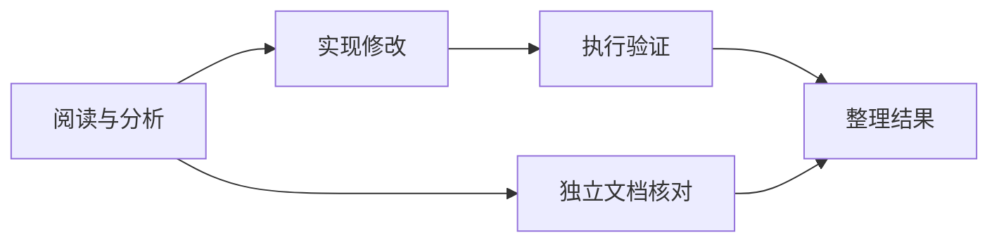

# 多 Agent 的先后顺序，交给 DAG：先拿到证据，再执行下一步

> “先阅读源码，再修改，再验证”是一条执行依赖。把它写进提示词有帮助，但真正保证第二步不会提前开始，需要调度系统理解这条依赖。

这是 [Cognitive OS](https://github.com/LeonQin-ai/cognitive-os-agent) 技术系列第 3 篇。上一篇的群聊适合讨论问题；这一篇关注有交付结果的多角色工作流。

## 这篇文章要解决什么问题？

本文围绕“从依赖声明理解 DAG 执行”展开。阅读顺序是：**依赖是什么 → 图如何编译 → 节点何时运行 → 失败如何传播 → 如何验证与优化**。先建立概念与执行顺序，再进入具体函数、异常分支和测试，避免把模块名当成理解系统的起点。

| 阅读阶段 | 要回答的问题 |
| --- | --- |
| 先明确依赖和输入的含义 | 角色名称描述分工，依赖边描述执行条件；先把两者区分，后续状态和调度才有依据。 |
| 图如何校验并编译成可执行层？ | 执行前检查节点与引用，再通过拓扑分层得到可检查的计划。 |
| 执行时怎样绑定结果并维护状态？ | 依赖满足后才绑定上游结果；共享文件和资源配额还需要图以外的约束。 |
| 上游失败时，下游如何停止与恢复？ | 用失败不变量解释阻断，再决定哪些节点允许重跑以及如何处理已有副作用。 |
| 如何通过 API 和中间态验证依赖？ | 验证必须观察抢跑窗口和失败后的状态，最终摘要无法独自证明执行次序正确。 |
| 层屏障有什么代价，何时值得优化？ | 先测量无关慢节点引入的等待，再讨论动态就绪调度需要增加的并发控制。 |

文中的源码行为以原文标注的 `cca98b6` 为阅读基线；涉及“应该”“可以”或后续演进的内容属于设计分析与验证建议。历史基准和故障记录不代表当前版本每次运行都会产生相同结果。

## 1. 先明确依赖和输入的含义

角色名称描述分工，依赖边描述执行条件；先把两者区分，后续状态和调度才有依据。

### 贯穿案例：为什么“总结”必须等待“阅读”完成？

设 A 读取规范，B 根据 A 的结果起草，C 独立检查目录结构，D 汇总 B 与 C。依赖关系为 `A → B → D` 和 `C → D`。这里 A、C 可以同时开始；B 的输入必须使用 A 已完成的结果；D 必须同时等待 B、C。

| 时刻 | 已知事实 | 允许发生的动作 |
| --- | --- | --- |
| 初始 | A、C 没有前驱 | 可安排 A、C |
| A 成功，C 未结束 | B 的直接依赖已满足 | 动态就绪策略可以安排 B；按层屏障执行则仍需等本层结束 |
| A 失败 | B 缺少必需输入 | B 不能继续基于空结果执行，D 也不能伪造完整汇总 |
| B、C 都成功 | D 的必需输入齐全 | 绑定对应版本的结果，再安排 D |

这张表区分了两种常被混淆的保证。拓扑关系定义“绝不能早于谁”；层屏障还可能引入“必须额外等待谁”。因此动态调度的优化目标是减少额外等待，同时保留依赖不变量。

验证时不要只看 D 最终说了什么。让 A 阻塞在可控的测试点，检查 B 是否尚未执行；再让 A 返回错误，检查 B、D 的状态；最后恢复成功路径，核对 D 的输入是否来自本轮结果。这样才能同时覆盖顺序、失败传播和结果绑定。这里的图是教学样例，状态枚举与具体 API 返回仍以固定版本实现为准。

### 角色分工和执行依赖是两件事

“分析师、开发者、验证者”定义了谁做什么，却没有自动规定什么时候可以做。假如分析师还在读取文件，开发者已经开始修改，工作流即使最终给出漂亮总结，也可能建立在不完整的输入上。

项目把这类关系编译为 DAG：节点描述角色和任务，边描述上游到下游的依赖。验证通过后，Runtime 按拓扑层执行，同层独立节点可以并行，后续层等待前驱结果。



层式执行比较直观，也有代价：某层中较慢的独立节点可能延后下一层。当前实现选择了清晰的依赖边界，并不宣称已经采用全局最优的动态调度。

### 引用结果，也是在声明依赖

一个可提交到 `POST /v1/flows` 的结构示意是：

```json
{
  "nodes": [
    {"id": "read", "agent": "reader", "task": "阅读指定源码，给出实际证据"},
    {"id": "review", "agent": "reviewer", "task": "基于 {{read}} 评审方案"}
  ],
  "edges": []
}
```

角色需要事先注册。这里即使没有显式写边，`{{read}}` 也意味着 review 依赖 read。否则一个节点可能在引用内容尚不存在时就启动。

校验还包括节点 ID 唯一、引用目标存在、禁止自引用和循环依赖。循环检测使用 Kahn 算法。错误结构应在执行前被拒绝，而不是让一组角色等待一个永远不会产生的结果。

### 显式边与结果占位符，各自表达不同意图

`{{read}}` 这样的占位符既传递上游文本，又建立启动依赖；显式边可以只表达顺序要求，不一定传递结果内容。这两种表达兼容常见工作流，但也带来一个选择：若节点只需要等待权限检查通过，却不想把检查输出拼到提示中，应使用显式边；如果需要引用结果，则可通过占位符建立数据依赖。

显式边和引用边指向同一节点对时应保持图结构一致。否则“边数量”和“实际前驱数”会不一致，层次计算与失败传播都可能被重复影响。编译期间将边统一进入邻接数组，执行阶段再基于这份标准化结构工作，减少不同输入表示造成的语义分叉。

占位符解析还要考虑格式错误：只有左括号没有右括号、空引用、超长引用、指向未知节点、自引用。对每个情形，测试应断言编译失败并不启动任何 Agent。仅断言 API 返回 400 不够，因为 handler 可能在返回错误前已提交部分节点；还应检查是否有节点状态或模型调用痕迹。

节点输出当前主要作为文本传给下游。文本带有自然语言歧义，也可能很长。若后续需要传结构化工件，可以设计显式输出端口和 schema，例如 `artifact://node-id/path`，再由可信的 Runtime 校验文件存在性和格式。直接把“我写好了文件”这句回答替换进下游，并没有建立文件对象的真实性。

### 讨论上下文不应变成新指令

还有一类细节容易让多 Agent 工作流误报失败。上游结果可能包含“已创建文件”“写入方案”等文本；下游只负责总结，却因为这些词被误判为自己也必须写文件。

项目将节点自己的用户任务与上游上下文分开，用当前节点的要求判断完成条件。证据用来帮助推理，不能悄悄扩大下游的执行职责。

这与群聊中把原始用户目标单独保留的思路一致：角色能读到更多信息，但信息来源和指令范围必须清楚。

### 先定义图的语义，再谈执行优化

Flow 提供的价值不是“多 Agent”这个名字，而是让依赖可以被静态检查、执行状态可以被逐节点观察、失败可以沿边传播。规模优化应该守住这些可解释性不变量；不然即使跑得更快，用户也无法知道某个结论依赖了什么。

## 2. 图如何校验并编译成可执行层？

执行前检查节点与引用，再通过拓扑分层得到可检查的计划。

### Flow 编译阶段的输入边界

阅读 `flow_parse()` 时，可以把输入结构分成四件事：节点定义、显式边、文本结果引用，以及用于执行的派生图结构。节点 ID 是图内引用键，agent 和 task 是执行所需的文本字段。编译阶段会先限制节点数量和字段长度，再检查 ID 唯一性，最后解析边与占位引用。任何不完整输入都应在执行前返回错误，不能让一个结构只构建了一半却继续进入调度。

字段长度检查看似是接口细节，实际与内存布局有关。当前实现把节点存入固定容量结构，ID、Agent 名和任务文本都有支持长度上限。若为了允许任意长文本而只删除检查，可能导致截断后两个不同 ID 映射到同一个数组字段，也可能使 `{{very-long-node}}` 无法安全解析。因此容量限制应对 API 使用者可见，并配套边界测试：最大合法长度通过，超过一个字节就被拒绝。

边的重复行为也值得明确。相同 from/to 的重复依赖可以去重，否则入度会重复增加，导致节点等待一个永远不会额外完成的前驱计数。单自环立即拒绝；多节点循环由拓扑排序未处理完全部节点来识别。未知节点 ID 的错误信息需要在释放 JSON 树之前复制原始名称，因为 `cJSON` 字符串是树内部借用内存，释放后再格式化错误会变成悬空指针。

这几类验证说明“解析成功”不仅是 JSON 语法正确，还包括图的语义满足不变量。一个普通 JSON Schema 能检查字段类型，却不一定表达引用图无环、结果引用必须指向已声明节点或重复边应该如何解释。编译器需要把这些跨字段关系显式检查出来。

### Kahn 分层如何把“先后”变成数据

编译阶段先建立邻接关系和入度，运行 Kahn 算法。入度为零的节点进入队列；弹出一个节点 u 后，遍历其后继 v，把 v 的层次更新为所有前驱层次加一的最大值，再减少入度。下面是源码核心节选：

```c
if (d->nodes[u].layer + 1 > d->nodes[v].layer)
    d->nodes[v].layer = d->nodes[u].layer + 1;
if (--indeg[v] == 0)
    queue[qt++] = v;
```

处理完成的节点数若小于总节点数，图中就存在无法消除的循环依赖。算法对已经建好的邻接结构是 `O(V + E)`；但 JSON 编译过程还包含 ID 查找、唯一性检查和引用解析，不能把整条接口路径都笼统写成线性复杂度。

分层使用最长前驱路径。假设 read 位于第 0 层，implement 和 doc 分别依赖 read，那么它们位于第 1 层；verify 依赖 implement，位于第 2 层；merge 依赖 verify 和 doc，位于第 3 层。这样执行第 L 层前，前面层的结果已经收集完毕。

### Kahn 算法留下的图信息

Kahn 算法每次取出一个入度为零的节点，遍历后继、降低它们的剩余入度。当某个后继的入度变为零时，说明它的所有前驱都已经被拓扑处理，可以进入下一队列。处理数等于 V 时无环；小于 V 时，至少仍有一个由环导致无法解锁的节点。

实现还记录每个节点的层数。遍历边 `u → v` 时，`layer[v]` 更新为 `max(layer[v], layer[u] + 1)`。因此层数表示最长前驱路径，而不是“距离最近根节点”。若节点有一条短路径和一条长路径，它必须等待长路径的前驱完成，才能安全执行。

拓扑队列里的节点次序可能取决于输入顺序。层数通常不变，但同层节点的呈现顺序可能变化。若需要稳定输出或可复现日志，应在同层按节点 ID 排序，或明确保留输入顺序；排序会增加编译成本并改变展示体验。现在无需为了理论上的确定性而隐藏输入顺序的影响，最好将其作为接口行为写清。

时间复杂度要分算法和编译过程。Kahn 遍历本身是 `O(V + E)`，存储邻接关系也与边数成正比；但当前实现通过线性扫描找节点索引，唯一性检查采用两层循环。对 V 个节点，唯一性检查最坏是 `O(V²)`；每条边做线性 ID 查找也会增加 `O(EV)` 项。节点上限限制了该成本范围，但不能将整个 JSON 编译路径简称为线性算法。

如果未来把节点规模上限大幅提升，哈希表可让 ID 查询平均接近常数时间，排序后的索引也可以做二分搜索。优化前应先测真实图规模与编译耗时，再决定增加索引结构是否值得。由于执行层每个节点通常会等待远程模型，编译微秒数不一定是整体瓶颈；反过来，实时编辑大量小图时，编译开销可能更重要。

### DAG 节点、依赖边与输入快照的版本

一个节点至少由 node ID、Agent、任务文本和运行结果组成。为了更可靠的恢复和审计，还可以为节点定义输入 hash、输出 artifact、尝试 ID、超时和副作用范围。这些字段把“某个 Agent 做过事情”转变成可以检查的数据契约。当前 Flow 以文本任务和文本输出为主要接口，更多字段属于可演进方向。

输入快照特别重要。节点 B 依赖 A 时，Runtime 应能说明 B 读到的究竟是 A 哪次结果。如果允许重新运行 A，旧 B 输出可能基于过期版本。可以给每次节点执行生成 attempt ID，并在 B 运行记录中保存父 attempt 的结果 hash；上游改变后，所有基于旧 hash 的下游结果就能标为 stale。

没有版本关联时，人工重跑的一部分图可能产生不一致：读者看到新的 A 和旧的 B，却不知道 B 仍引用旧输出。即使暂时不提供缓存复用，也应在日志中记录本次实际替换进去的上游文本或其 hash，方便复盘结果来源。

分支合并也需要明确冲突策略。两个节点分别输出不同的建议，合并节点收到二者并不代表系统已经决定哪一个优先。合并任务应说明按什么准则比较、保留分歧还是生成统一结论。若多个上游同时写共享文件，文本依赖图更无法自动解决写写冲突，需在产物模型中增加单一写者或显式 merge 节点。

## 3. 执行时怎样绑定结果并维护状态？

依赖满足后才绑定上游结果；共享文件和资源配额还需要图以外的约束。

### 结果替换为什么必须在依赖满足之后

`{{read}}` 是结果占位符，也是数据依赖。编译时把它转成边，运行时再将已完成的 read 输出替换进下游任务。若只做文本替换、不建立依赖，最常见的坏结果是空字符串进入下游，而下游模型仍能编造一份看起来完整的方案。

对开发者而言，更严格的交付契约还可以包括结果类型、输出文件及验证标准。当前占位符主要传递文本结果，不应被描述为已经拥有任意结构化产物的强类型系统。特别是一个节点返回“文件已生成”，后续节点仍应核对文件，而不是把这句话当作文件本身。

还有一个细节是长度：模型上下文和节点任务缓冲都有上限，拼接多个大结果不等于无限传递证据。长输出适合保存在可检索的产物中，再传引用和必要摘要；这属于设计方向，是否已经实现到具体路径要以源码与测试为准。

### 节点输出如何进入子任务 prompt

结果替换时要避免把上游内容误认为结构语法。若输出文本含有字符串 `{{node-id}}`，下游模板处理器是否递归替换？通常应该只在原始 task 模板阶段解析占位符，再把上游结果作为普通 payload 插入，避免其内容继续被解释为新的引用。

插入上游文本时还要限制总长度并保留来源标记。若多个节点都返回大段源码，合并后可能超过模型窗口。系统可以存完整结果到 artifact storage，仅将有界摘要与结果引用传给子节点；但摘要应包含 hash 和原文位置，以便需要时读取具体证据。

节点输出的编码需要保持一致。模型回复是 UTF-8 字符串，JSON 序列化应正确转义控制字符和引号；若把未经转义的内容直接拼进 JSON，源结果中的换行就会破坏查询 API。把结果当作字符串对象传递比手工拼接 JSON 更稳健。

### 节点状态表就是一个小状态机

在 API 中看到 `queued`、`running`、`ok`、`error`、`blocked`、`cancelled` 和 `timeout`，不要只把它们当字符串。它们描述从可执行到终止的状态机。基本约束包括：终态不能重新变成 running；blocked 节点不能被下游误当成功；父任务取消后不再启动新的节点；已运行节点可记录自己的失败原因，而 blocked 节点记录阻断它的前驱。

| 当前状态 | 允许的后续变化 | 必须保留的信息 |
| --- | --- | --- |
| queued | running、blocked、cancelled、timeout | 层号、未满足依赖、父任务状态 |
| running | ok、error、cancelled、timeout | 开始时间、Agent、输出或错误 |
| ok | 终态 | 成功输出与完成时间 |
| error | 终态 | 失败原因、已执行副作用线索 |
| blocked | 终态 | 导致阻断的上游节点 |
| cancelled | 终态 | 用户或父任务取消原因 |
| timeout | 终态 | 超时预算和截止时间 |

表格是设计用的状态约束，不替代源码的确切转移逻辑。状态写入还需要避免 API 读取到一半更新的数据；并发读取可依赖进度 registry 的锁或快照机制。用户界面应把“上游失败导致 blocked”和“本节点调用 Agent 后 error”分开呈现，因为用户采取的恢复动作不同。

状态名和进度百分比也不能混为一谈。一个 running 节点可能多次规划、调用工具、等待 Provider。静态 DAG 节点状态不能表达内部推理进展，所以实现另有运行中 Reasoning 指针为查询提供阶段信息。这个桥接需要安全地读取短生命周期对象，锁范围和对象撤销顺序同样值得重点审查。

### 共享文件会不会绕过 DAG

DAG 只约束声明过的依赖。假设两个同层节点都修改 `config.json`，即使没有边，它们仍可能争用同一个外部资源。拓扑独立不等于副作用独立，线程并发也不会自动提供文件级串行化。

适合的处理方式包括：给共享写入建立依赖、为每个角色提供独立产物目录、由一个合并节点统一应用修改，或在工具层设计资源锁。这些是工作流设计需要考虑的措施，不能把当前文本 DAG 当作对任意 shell 副作用的事务调度器。

同样，重跑失败节点前应确认外部操作是否可重复执行。生成本地临时报告与提交一次远程订单，不能采用同一套盲目重试策略。

### 限制节点数不等于限制实际资源

静态最大节点数限制了图的内存上界，但每个节点任务文本可以接近字段最大长度，替换后的上游结果也可能增长。若 64 个节点都各有很长描述，单个 JSON 请求仍可能很大；若多个并发 Flow 同时运行，线程、prompt 和输出缓冲按任务数叠加。资源保护还需总请求大小、单节点输入、累计结果、并发 Flow 数与最大等待时间。

`FLOW_MAX_PARALLEL` 将同一层的实际并行批次限制在 8。8 是当前常量，不代表目标机器总有 8 个空闲核心，也不代表 Provider 允许 8 个并行请求。若同时有多个 Flow，整体并行数可能高于每个 Flow 的上限；全局 WorkerPool、模型速率限制和租户配额仍会进一步影响实际并发。

为避免一张 DAG 占满所有工作线程，运行时可以考虑全局并发门、每模型并发限制、租户公平调度或 Flow 优先级。但这会引入队列层级和潜在死锁：若一个 Flow 的父容器占住 worker，同时等待其子节点，而子节点也必须等同一个已满 worker pool，就可能永远无法运行。因此资源分配要确保协调任务不会耗尽子任务所需容量，或让父 Flow 使用独立协调线程/异步状态机。

在限流环境中，排队比并发更重要。若 Provider rate limit 是每分钟请求数，即使 worker 空闲，节点也应该根据 token bucket 或响应中的 retry-after 排队等待。把被限流重试任务立即放回 ready queue，可能形成忙等并使其他 Provider 请求饥饿。限流调度是 Flow 层、Reasoning 层还是 Provider adapter 层负责，应有单一清楚的边界。

## 4. 上游失败时，下游如何停止与恢复？

用失败不变量解释阻断，再决定哪些节点允许重跑以及如何处理已有副作用。

### 上游失败后，下游应该是什么状态

如果 read 失败，review 没有执行条件。合适的状态是 `blocked`，而不是把它伪装成完成，也不是让模型自行猜测上游原本想输出什么。

当前节点进度区分 `queued`、`running`、`ok`、`error`、`blocked`。失败依赖会阻断后代节点；没有依赖关系的分支仍可完成。整体任务保留部分结果，并如实报告失败。

这样，用户可以看清“某一步执行失败”和“某一步因此没有执行”的区别。这对恢复与排错都很有价值：错误传播被写成系统行为，不依赖最后一段总结是否足够诚实。

### 失败传播的最小不变量

运行时在启动某节点前查看它的前驱返回码。上游未成功则标记 blocked，根本不调用该节点的模型。这样可以维持下面这个不变量：

```text
节点进入 running
    ⇒ 所有直接前驱都已成功
    ⇒ 它引用的上游结果已可用
```

一个小图就能检验传播是否正确：A → B → C，另外有独立 D。让 A 失败，预期 A=error、B=blocked、C=blocked、D=ok。不能只阻断 B 却让 C 运行，因为 C 依赖的并不是“B 曾被访问”，而是“B 已成功完成”。

| 情况 | 当前节点是否应调用模型 | 应保留的信息 |
| --- | --- | --- |
| 前驱成功 | 可以 | 上游结果、当前节点任务 |
| 前驱执行失败 | 不应 | 阻断它的前驱 ID |
| 父任务取消 | 不应再启动新工作 | cancelled 与取消原因 |
| 父任务超时 | 不应再启动新工作 | timeout 与时间边界 |
| 独立分支失败 | 依赖未受影响时可继续 | 各分支各自结果 |

blocked 的价值是解释因果。如果所有未完成节点都只写 error，用户无法区分“这个工具真的执行失败”和“它因为上游失败而根本没执行”。

### 失败传播的时间点和竞态

层式实现比较容易在一层结束时检查依赖，但取消和失败仍可能与多个 worker 的完成竞争。比如用户在本层最后一个节点返回时点击取消，调度线程要决定是把下一层 queued 项标成 cancelled，还是因为最后节点成功而启动它们。状态转移需要由父任务取消标记和统一同步规则决定，不能靠 UI 最后显示哪一个事件。

当两个前驱都失败时，后继 blocked 原因应该能记录多个前驱或至少稳定地选择一个主要原因。若只保存第一个失败节点，用户仍可查看完整任务历史得到其他失败；若希望 UI 呈现全部原因，应在节点状态里保存依赖错误集合。仅写“上游失败”会增加人工回溯成本。

依赖传播最好按图遍历并避免对每个失败节点重复扫描整张图。节点数受限时，简单扫描可能足够；高规模图可预先构建后代关系或计数数组。优化应与测试规模结合：用链、菱形、宽层、多个根和多个失败点覆盖传播，不只用一条线性 DAG。

还需区分“节点失败”和“编译失败”。未知角色、循环依赖、非法占位符应该在任何模型调用前拒绝整张图；运行时失败则发生在部分节点已经工作之后，可能保留部分结果。API 错误码、父任务状态和节点状态应反映这两种根本不同的情况。

### 失败恢复时要先决定重跑边界

若 A → B → C 中 B 失败，重试 B 是否安全取决于 B 的副作用；若 B 已创建文件但在回报结果时崩溃，重跑可能覆盖它，也可能重复写入。若 B 曾发远程请求，结果不确定时重试可能重复产生影响。Flow 的图依赖本身无法推导副作用是幂等的。

一个更易恢复的工作流通常让每个节点写入独立目录，以 node ID 和尝试 ID 命名结果，之后由一个提交节点进行原子合并。这样失败重跑不容易覆盖其他节点的输出。真正的业务操作仍需幂等键或状态查询；本地文件快照只管理它覆盖的路径。

如果只重跑失败节点，必须保证其上游结果仍可用且版本仍匹配；若上游输入改变，下游的旧输出可能失效。可通过为节点输入保存内容 hash、输出保存来源 hash 来检测陈旧结果。当前工作流的文本替换并不自动提供缓存失效或依赖结果版本协议，这些可以作为后续改造方向讨论。

部分成功对用户很有价值，但汇总时应列出成功、失败与阻断分支。比如 A、D 成功，B 因 A 失败而 blocked，另一条独立分支 E 成功：运行报告不应压缩成“一切失败”，也不应写成“流程完成”。准确的状态保留了可继续工作的结果，同时让用户知道哪些结论还缺证据。

## 5. 如何通过 API 和中间态验证依赖？

验证必须观察抢跑窗口和失败后的状态，最终摘要无法独自证明执行次序正确。

### Flow API 从创建到查询的验证顺序

客户端先将 JSON 交给 Flow handler。服务端应先验证文档体和节点，再确认 Agent 已注册，最后编译依赖图并提交父任务。若把“Agent 是否存在”留到节点启动以后才发现，图中的其它节点可能已经开始执行，给用户造成部分提交的困惑。

成功返回父 task ID 后，查询任务状态与查询各节点状态也有不同粒度。父任务可能是 RUNNING，而部分 node 已 ok、另一些 queued；父任务 FAILED 时，也需要保留每个节点的终态。前端的总体进度不能只用“已完成节点 / 总节点”计算，因为 blocked 节点不是耗时失败，也不一定需要用户重试。

工作流执行线程和调度器 worker 之间还存在嵌套并发。如果父 Flow 的 runner 占用一个 Scheduler worker，再为每层创建线程，实际线程总数可能超过单一配置值。规模测试应记录进程总线程，而不只记 Scheduler worker count。运行环境的线程限制和 stack size 也会影响最大可并行层数。

错误 API 可以区分 HTTP 请求格式无效、Agent 未注册、图有循环、任务已接纳后节点失败。对前几类错误应在返回前无副作用；对后一类要返回 task ID 供查询，并通过任务资源暴露部分结果。客户端在收到连接断开时也不能推断提交失败，因为服务端可能已接纳请求；幂等 request ID 能帮助安全查询。

### 设计一个用于读懂 DAG 的小型实验

选一个纯文本小文件，创建 `read` 节点读取特定行，`analyze` 节点基于 `{{read}}` 给出解释，再添加独立 `inventory` 节点列出同一目录文件，最后 `report` 节点引用两个结果。图形结构形成“链加分支”，比单纯 A → B 更能展示最大层、并行分支和多前驱合并。

在第一次运行中让 `read` 正常返回，核对 `analyze` 没有在之前开始；再让 `inventory` 延迟，确认报告受两个前驱共同约束。随后只让 `inventory` 失败，观察 `analyze` 是否保留成功、`report` 是否 blocked。失败节点的错误不应被后续 summary 改写成“全流程成功”。

接下来修改源文件并重新运行。由于当前系统没有完整的跨运行 DAG 结果缓存，不应期待它自动跳过未变化节点；每次执行都要核对读到的新版本。如果你自己做缓存实验，必须同时验证源文件 hash 变化时缓存失效，否则“节省调用”可能只是复用了过期内容。

一个演示表可以记录提交顺序、层号、节点 start/end、Agent 调用次数、上游输出标记和最终状态。给听众看表格比只显示一张 DAG 图更能解释层屏障的执行语义。

### 写一个能够暴露“抢跑”的端到端测试

确定性依赖测试需要一个可暂停的 Agent fixture。测试提交 A → B，等待 A 进入 running，并让 A 阻塞在 barrier。此时查询父任务和模型调用记录，断言 B 仍 queued、其调用次数为零、输出路径不存在。随后释放 A，让它返回唯一的 `SOURCE_READY_7C` 标记，观察 B 进入 running，确认 B 的输入包含该标记。

还应在 A 处制造两个错误：返回非零失败、或报告成功但输出为空。前者应让 B blocked；后者的处理取决于成功语义，如果空文本允许，则需要 schema 显式声明；否则应在输出验证阶段判为失败，避免模型收到一个空依赖。失败后 D 这样的独立节点可以继续，检查系统不会错误地将整张图的所有独立分支一并取消。

时序断言应使用 barrier，不要写 `sleep(1)` 后直接查询。CI 机器可能在睡眠期间没有调度测试进程，导致用例偶尔错过 queued 窗口。barrier 能稳定制造“上游仍运行”的状态，并在测试结束时通过 defer/finally 释放，避免断言失败后遗留挂起线程。

响应体还应验证层号、状态和错误原因可稳定序列化，且 JSON 完整。并发查询可以在节点切换时循环调用 progress API，确保不会出现负数 active、同一节点重复 running 或输出数据尚未写入就显示 ok。若进度 registry 有并发上限，还要覆盖同时运行多个 Flow 时旧记录如何回收。

### 测试依赖，关键是观察中间态

只检查最终文件存在，无法证明执行顺序正确。HTTP 回归会阻塞第一步的模型响应，在它尚未释放时查询节点状态，确认第二步仍为 queued、没有调用其模型、也没有生成目标文件。之后释放上游，检查下游开始时间不早于前驱结束时间。

另一组用例故意让上游失败，确认其子孙 blocked，而独立分支正常完成。这些都是可重复的控制流测试，使用本地 fixture，不需要付费模型。

源码：[Flow 编译与执行](https://github.com/LeonQin-ai/cognitive-os-agent/blob/main/backend/src/runtime/flow.c)、[接口定义](https://github.com/LeonQin-ai/cognitive-os-agent/blob/main/backend/include/runtime/flow.h)。验证：[依赖端到端测试](https://github.com/LeonQin-ai/cognitive-os-agent/blob/main/backend/tests/test_flow_dependencies_e2e.py)。

### 面试中如何展示 DAG 语义

最短的展示方式是画 A → B → C，并加入独立 D。让 A 被 fixture 挂起，查询状态时证明 B 仍 queued 且模型调用计数为零；释放 A 后，检查 B 的 prompt 包含 A 输出。随后另跑一次让 A 失败，预期 B blocked、C blocked，而 D 仍完成。

这个演示同时展示依赖解析、运行时门禁、失败传播与并行分支。需要谨慎说明：它证明的是被测 fixture 下的 DAG 控制流，不证明任何模型生成的计划都正确，也不证明共享文件副作用是隔离的。性能演示还要另测并行度、每批节点数和 Provider 限制。

面试官常会追问为什么不让所有步骤并发。回答可以落到因果关系：没有 A 的证据时，B 不能基于它写代码；但无依赖的 D 可以并行。若 A 完成得早，层屏障可能让 C 等待另一个同层慢节点，这是当前实现的代价。我们可以先通过节点时间线量化，再决定实现动态就绪队列是否划算。

## 6. 层屏障有什么代价，何时值得优化？

先测量无关慢节点引入的等待，再讨论动态就绪调度需要增加的并发控制。

### 用一个反例看懂层屏障

假设 A 耗时 1 秒，B 耗时 10 秒，两者均在第 0 层；C 只依赖 A，耗时 1 秒。当前层式执行需要等待 A、B 都完成，再启动 C，总时长约 11 秒。若使用依赖就绪的动态调度，C 可以在 A 完成后启动，整张图约 10 秒结束。

```text
层式屏障：A [1s] ─────────┐
          B [   10s    ] ─┴→ C [1s]

动态就绪：A [1s] → C [1s]
          B [   10s    ]
```

这是当前设计可以明确指出的取舍。层式执行更容易审查“上游结果是否已收集”，但有长尾等待；动态调度能减少不必要的屏障，却需要更细地维护完成计数、失败传播、取消以及结果发布的同步。

源码还限制每层的执行并行度，按 `FLOW_MAX_PARALLEL` 分批创建线程并 join。因此同层有很多节点，也不意味着所有节点立刻同时运行；某一批里较慢的节点还可能推迟下一批。讨论性能时应把拓扑并行度和实现的资源上限分开。

### 层屏障的时间模型与动态调度

当前按层分批执行。同层最多同时创建 8 个工作线程；节点数超过 8 时会拆成多批，每一批 join 完成后才进入该层的下一批，所有本层完成后再处理下一层。实际临界路径因此不仅是 DAG 的最长路径，也受批次分组和每层的最慢任务影响。

可用下面的公式做粗略估算：

```text
T_layered ≈ Σ_level Σ_batch max(duration(node) in batch)
T_dynamic ≥ max(path_sum(source → sink))
```

第二行是理想动态执行的下界形式，不包括调度、资源竞争、失败处理和模型速率限制。实际动态调度不保证一定更快：若同一 Provider 有并发限额，启动更多请求可能导致限流；若节点争用相同文件，重叠执行反而会增加重试和损坏风险。

动态就绪调度需要为每个节点维护剩余成功前驱数。前驱成功时递减计数，到零即入队；前驱失败时遍历后代并标记 blocked；并发完成时，需要保证某节点只获得一次 ready 转移。还要处理取消到来时尚未启动的就绪节点、节点运行时子任务失败、父任务超时，以及输出结果只发布一次等状态竞争。

因此更合适的工程步骤是：先给层式执行添加每节点开始/结束时间、批次号和队列等待数据，找出屏障是否真实造成主要延迟；然后构建可配置的调度策略，用同一 DAG 和可控 duration fixture 做对照；最后才决定是否提高实现复杂度。已有算法边界应该作为测试基线保留，避免优化破坏依赖安全。

### 动态调度的实现前置条件

如果以后把分批屏障换成动态就绪队列，可以将每个节点状态抽象成以下计数：`pending_predecessors`、`success_count`、`failure_count` 与 `attempt`. 节点进队列只发生一次，并由原子状态变更保证；完成事件更新后继计数也只能执行一次。重复 completion callback 不能重复解锁后继。

队列事件还需和取消统一排序。取消线性化点前已经入 ready 的节点可能仍未启动，应在取出时检查父任务代次与状态；取消线性化点之后完成的节点可以记录成功结果，但不得启动新的依赖后继。否则用户看到取消成功后，系统还可能开始下一步写文件。

动态调度带来更短临界路径，但层级解释会弱化。用户可能看到 C 已开始，而同一层的 B 仍在运行，这符合依赖语义，却不再是整层统一阶段。UI 得提供每节点依赖和时间线；事故复盘需要保存“哪个完成事件触发了 C”。运行状态越动态，结构化事件越重要。

在动手实现之前，最好用纯模拟调度器验证图算法，不启动真实 Agent：给节点分配可控的虚拟耗时，比较层式和动态调度结果，检查所有拓扑约束始终成立。随后再将相同事件序列接入真实 worker 与 fixture，确认取消、超时和失败传播兼容。先验证调度状态机再接 Provider，降低问题排查成本。

### 从层式执行走向动态就绪调度

当前实现通过显式边和结果占位符控制启动条件。占位符表达数据引用，显式边还可以表达没有文本传递的顺序要求，例如先完成权限检查，再允许发布。

如果进一步采用动态就绪调度，需要先维持节点唯一终态、结果只发布一次、成功前驱计数和失败阻断等不变量，再处理取消与完成之间的竞争。只有这些条件可检查，减少层屏障的性能优化才不会破坏依赖语义。

源码阅读基线：[图编译、Kahn 分层、分批执行与失败传播](https://github.com/LeonQin-ai/cognitive-os-agent/blob/cca98b6/backend/src/runtime/flow.c)。

## 延伸阅读与实践顺序

完成本文后，建议选取“执行时怎样绑定结果并维护状态？”中的一个分支，用固定输入记录预期行为、实际结果和差异。先验证一个具体不变量，再扩大任务规模；若结果不同，优先核对源码版本、配置与输入证据。


上一篇：[多轮讨论](02-agent-group-discussion.md)；下一篇：[Memory 与 Context](04-memory-and-context.md)。欢迎用一个包含失败分支的真实任务，检验这套依赖模型是否满足你的工作流。
