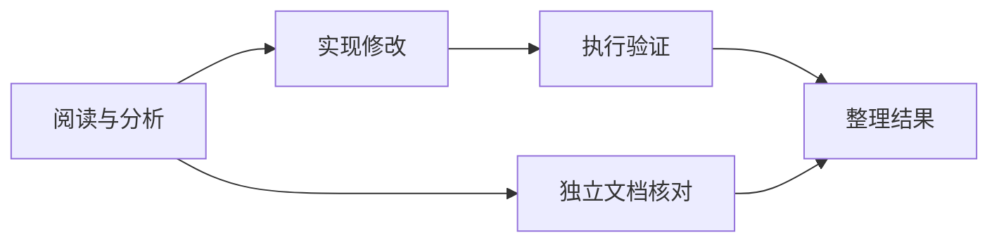

# 多 Agent 的先后顺序，交给 DAG：先拿到证据，再执行下一步

> “先阅读源码，再修改，再验证”是一条执行依赖。把它写进提示词有帮助，但真正保证第二步不会提前开始，需要调度系统理解这条依赖。

这是 [Cognitive OS](https://github.com/LeonQin-ai/cognitive-os-agent) 技术系列第 3 篇。上一篇的群聊适合讨论问题；这一篇关注有交付结果的多角色工作流。

## 角色分工和执行依赖是两件事

“分析师、开发者、验证者”定义了谁做什么，却没有自动规定什么时候可以做。假如分析师还在读取文件，开发者已经开始修改，工作流即使最终给出漂亮总结，也可能建立在不完整的输入上。

项目把这类关系编译为 DAG：节点描述角色和任务，边描述上游到下游的依赖。验证通过后，Runtime 按拓扑层执行，同层独立节点可以并行，后续层等待前驱结果。



层式执行比较直观，也有代价：某层中较慢的独立节点可能延后下一层。当前实现选择了清晰的依赖边界，并不宣称已经采用全局最优的动态调度。

## 引用结果，也是在声明依赖

一个可提交到 `POST /v1/flows` 的结构示意是：

```json
{
  "nodes": [
    {"id": "read", "agent": "reader", "task": "阅读指定源码，给出实际证据"},
    {"id": "review", "agent": "reviewer", "task": "基于 {{read}} 评审方案"}
  ],
  "edges": []
}
```

角色需要事先注册。这里即使没有显式写边，`{{read}}` 也意味着 review 依赖 read。否则一个节点可能在引用内容尚不存在时就启动。

校验还包括节点 ID 唯一、引用目标存在、禁止自引用和循环依赖。循环检测使用 Kahn 算法。错误结构应在执行前被拒绝，而不是让一组角色等待一个永远不会产生的结果。

## 上游失败后，下游应该是什么状态

如果 read 失败，review 没有执行条件。合适的状态是 `blocked`，而不是把它伪装成完成，也不是让模型自行猜测上游原本想输出什么。

当前节点进度区分 `queued`、`running`、`ok`、`error`、`blocked`。失败依赖会阻断后代节点；没有依赖关系的分支仍可完成。整体任务保留部分结果，并如实报告失败。

这样，用户可以看清“某一步执行失败”和“某一步因此没有执行”的区别。这对恢复、排错和面试讲解都很有价值：错误传播被写成系统行为，不依赖最后一段总结是否足够诚实。

## 讨论上下文不应变成新指令

还有一类细节容易让多 Agent 工作流误报失败。上游结果可能包含“已创建文件”“写入方案”等文本；下游只负责总结，却因为这些词被误判为自己也必须写文件。

项目将节点自己的用户任务与上游上下文分开，用当前节点的要求判断完成条件。证据用来帮助推理，不能悄悄扩大下游的执行职责。

这与群聊中把原始用户目标单独保留的思路一致：角色能读到更多信息，但信息来源和指令范围必须清楚。

## Kahn 分层如何把“先后”变成数据

编译阶段先建立邻接关系和入度，运行 Kahn 算法。入度为零的节点进入队列；弹出一个节点 u 后，遍历其后继 v，把 v 的层次更新为所有前驱层次加一的最大值，再减少入度。下面是源码核心节选：

```c
if (d->nodes[u].layer + 1 > d->nodes[v].layer)
    d->nodes[v].layer = d->nodes[u].layer + 1;
if (--indeg[v] == 0)
    queue[qt++] = v;
```

处理完成的节点数若小于总节点数，图中就存在无法消除的循环依赖。算法对已经建好的邻接结构是 `O(V + E)`；但 JSON 编译过程还包含 ID 查找、唯一性检查和引用解析，不能把整条接口路径都笼统写成线性复杂度。

分层使用最长前驱路径。假设 read 位于第 0 层，implement 和 doc 分别依赖 read，那么它们位于第 1 层；verify 依赖 implement，位于第 2 层；merge 依赖 verify 和 doc，位于第 3 层。这样执行第 L 层前，前面层的结果已经收集完毕。

## 用一个反例看懂层屏障

假设 A 耗时 1 秒，B 耗时 10 秒，两者均在第 0 层；C 只依赖 A，耗时 1 秒。当前层式执行需要等待 A、B 都完成，再启动 C，总时长约 11 秒。若使用依赖就绪的动态调度，C 可以在 A 完成后启动，整张图约 10 秒结束。

```text
层式屏障：A [1s] ─────────┐
          B [   10s    ] ─┴→ C [1s]

动态就绪：A [1s] → C [1s]
          B [   10s    ]
```

这是当前设计可以明确指出的取舍。层式执行更容易审查“上游结果是否已收集”，但有长尾等待；动态调度能减少不必要的屏障，却需要更细地维护完成计数、失败传播、取消以及结果发布的同步。

源码还限制每层的执行并行度，按 `FLOW_MAX_PARALLEL` 分批创建线程并 join。因此同层有很多节点，也不意味着所有节点立刻同时运行；某一批里较慢的节点还可能推迟下一批。讨论性能时应把拓扑并行度和实现的资源上限分开。

## 结果替换为什么必须在依赖满足之后

`{{read}}` 是结果占位符，也是数据依赖。编译时把它转成边，运行时再将已完成的 read 输出替换进下游任务。若只做文本替换、不建立依赖，最常见的坏结果是空字符串进入下游，而下游模型仍能编造一份看起来完整的方案。

对开发者而言，更严格的交付契约还可以包括结果类型、输出文件及验证标准。当前占位符主要传递文本结果，不应被描述为已经拥有任意结构化产物的强类型系统。特别是一个节点返回“文件已生成”，后续节点仍应核对文件，而不是把这句话当作文件本身。

还有一个细节是长度：模型上下文和节点任务缓冲都有上限，拼接多个大结果不等于无限传递证据。长输出适合保存在可检索的产物中，再传引用和必要摘要；这属于设计方向，是否已经实现到具体路径要以源码与测试为准。

## 失败传播的最小不变量

运行时在启动某节点前查看它的前驱返回码。上游未成功则标记 blocked，根本不调用该节点的模型。这样可以维持下面这个不变量：

```text
节点进入 running
    ⇒ 所有直接前驱都已成功
    ⇒ 它引用的上游结果已可用
```

一个小图就能检验传播是否正确：A → B → C，另外有独立 D。让 A 失败，预期 A=error、B=blocked、C=blocked、D=ok。不能只阻断 B 却让 C 运行，因为 C 依赖的并不是“B 曾被访问”，而是“B 已成功完成”。

| 情况 | 当前节点是否应调用模型 | 应保留的信息 |
| --- | --- | --- |
| 前驱成功 | 可以 | 上游结果、当前节点任务 |
| 前驱执行失败 | 不应 | 阻断它的前驱 ID |
| 父任务取消 | 不应再启动新工作 | cancelled 与取消原因 |
| 父任务超时 | 不应再启动新工作 | timeout 与时间边界 |
| 独立分支失败 | 依赖未受影响时可继续 | 各分支各自结果 |

blocked 的价值是解释因果。如果所有未完成节点都只写 error，用户无法区分“这个工具真的执行失败”和“它因为上游失败而根本没执行”。

## 共享文件会不会绕过 DAG

DAG 只约束声明过的依赖。假设两个同层节点都修改 `config.json`，即使没有边，它们仍可能争用同一个外部资源。拓扑独立不等于副作用独立，线程并发也不会自动提供文件级串行化。

适合的处理方式包括：给共享写入建立依赖、为每个角色提供独立产物目录、由一个合并节点统一应用修改，或在工具层设计资源锁。这些是工作流设计需要考虑的措施，不能把当前文本 DAG 当作对任意 shell 副作用的事务调度器。

同样，重跑失败节点前应确认外部操作是否可重复执行。生成本地临时报告与提交一次远程订单，不能采用同一套盲目重试策略。

## 面试追问：依赖和调度的边界

**为什么不能只在角色提示词里写“等第一步完成”？** 提示词不能阻止线程提前启动，也不能使空结果自动变成真实结果。依赖必须影响启动条件。

**有 `{{node}}` 以后，还需要显式 edges 吗？** 需要。占位符表达数据引用，显式边还可以表达没有文本引用的顺序约束，例如先完成权限检查，再允许发布。

**怎样证明下游没有偷跑？** 控制上游的释放时刻，并在此之前检查下游模型调用数与文件副作用，而不只比较最终消息顺序。页面上的显示次序可能受缓冲与网络影响。

**如果要改成动态就绪调度，你会先补什么？** 先建立每个节点唯一终态、结果只发布一次、成功前驱计数和失败阻断的状态不变量，再测取消与完成竞争。先有可检查的不变量，性能优化才有可靠基础。

源码阅读基线：[图编译、Kahn 分层、分批执行与失败传播](https://github.com/LeonQin-ai/cognitive-os-agent/blob/cca98b6/backend/src/runtime/flow.c)。

## 测试依赖，关键是观察中间态

只检查最终文件存在，无法证明执行顺序正确。HTTP 回归会阻塞第一步的模型响应，在它尚未释放时查询节点状态，确认第二步仍为 queued、没有调用其模型、也没有生成目标文件。之后释放上游，检查下游开始时间不早于前驱结束时间。

另一组用例故意让上游失败，确认其子孙 blocked，而独立分支正常完成。这些都是可重复的控制流测试，使用本地 fixture，不需要付费模型。

源码：[Flow 编译与执行](https://github.com/LeonQin-ai/cognitive-os-agent/blob/main/backend/src/runtime/flow.c)、[接口定义](https://github.com/LeonQin-ai/cognitive-os-agent/blob/main/backend/include/runtime/flow.h)。验证：[依赖端到端测试](https://github.com/LeonQin-ai/cognitive-os-agent/blob/main/backend/tests/test_flow_dependencies_e2e.py)。

上一篇：[多轮讨论](02-agent-group-discussion.md)；下一篇：[Memory 与 Context](04-memory-and-context.md)。欢迎用一个包含失败分支的真实任务，检验这套依赖模型是否满足你的工作流。
